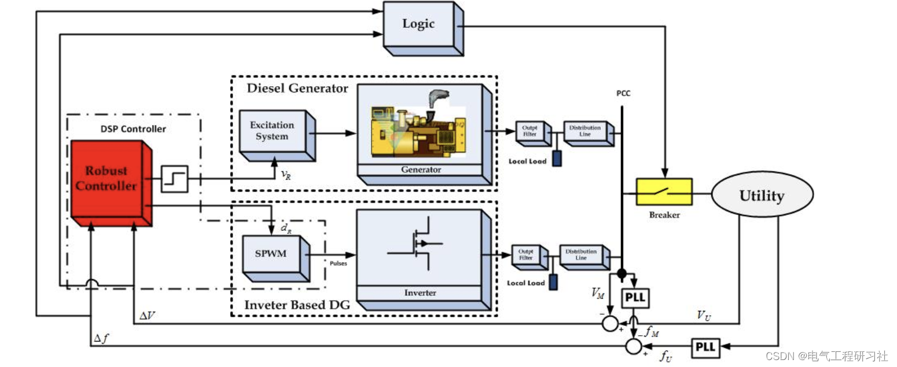
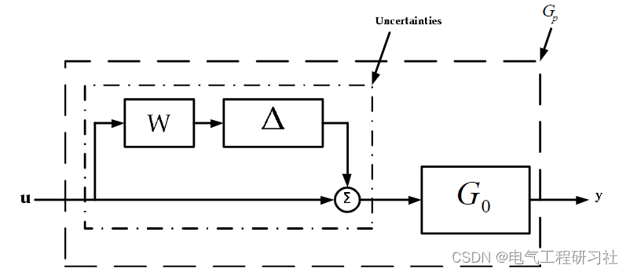
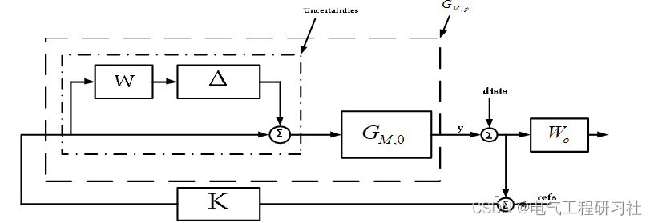
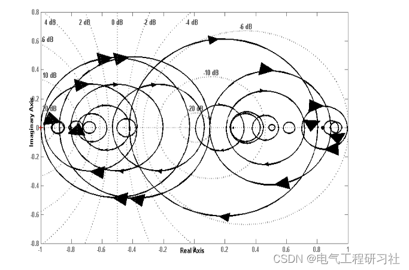
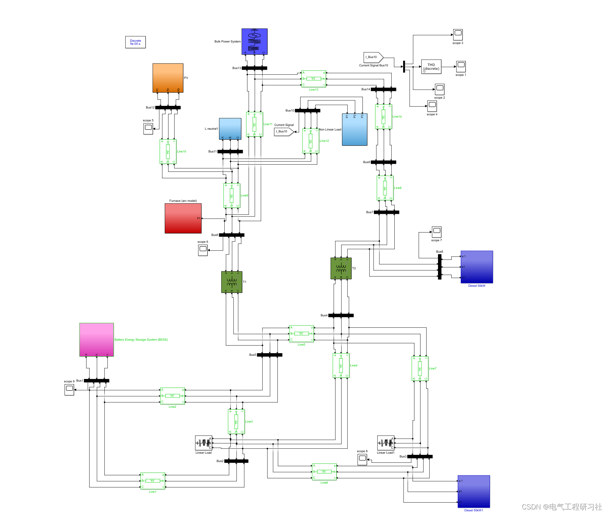
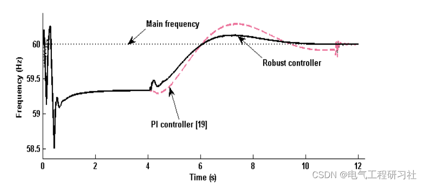
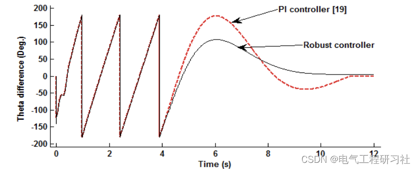
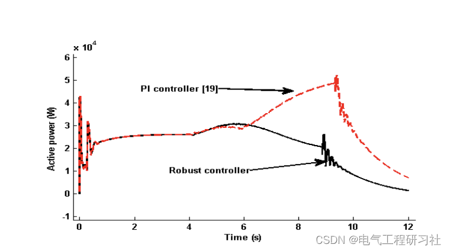
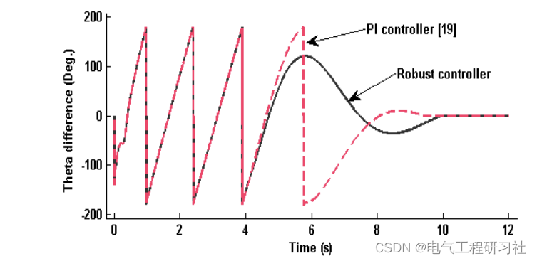

# Yuanchuang Essay | Optimal Dispatch of Microgrid Based on Robust Control Theory (Matlab Code Implementation)

1. Overview and Summary---The microgrid is the main component of future power systems, known as the "smart grid". In this case, synchronization of the microgrid with the utility or other microgrids will be a crucial and common task during the operation of the power system. Based on robust control principles, this paper proposes a new method for synchronizing the microgrid with the utility. The uncertainty in the dynamic model of the microgrid is considered to be multiplicative disturbances. On the basis of the uncertain model, a robust controller is designed through μ-synthesis analysis to maximize the system's robust stability and performance. Simulation results confirm the effectiveness of the proposed control strategy.
In the presence of system uncertainty related to unmodeled dynamics and line parameter distribution, this paper addresses the problem of synchronizing the microgrid with the utility by designing a robust controller based on μ-synthesis analysis. Through simulation analysis, six case studies were used to test the performance of the proposed method. The first three case studies consider network delay as the system uncertainty. Considering changes in the parameters of the system model, the last three case studies verify the impact of such changes on the synchronization of the microgrid with the utility. These simulated studies confirm the effectiveness of the proposed method.
The structure of this paper is as follows: Section 2 describes the structure and dynamics equations of the system under study. Section 3 describes the principle of synchronizing the microgrid with the utility using the proposed method. Section 4 provides a brief review of designing a robust controller using μ-synthesis analysis and the design procedure for determining the robust controller based on the system under study using μ-synthesis analysis. Section 5 presents the case studies and simulation results. Finally, Section 6 summarizes the paper. Due to space limitations, detailed mathematical models are presented in Part 4.
2.1 Diesel generator dynamic model
2.2 Inverter-based DG model
2.3 Microgrid model
By using Equations (1)-(3) and Kirchhoff's laws, and selecting appropriate state variables as the microgrid's state space model, the form is:
Where:
And so on.
3. Synchronous Principle of Using Proposed Method
The voltage and frequency of the utility are considered as reference inputs in this figure.
Editor
4. Robust Controller Design Based on μ-Analyses
4.1 Overview: This section provides an overview of robust controller design based on μ-analyses. Robustness is crucial in control system design due to the vulnerability of actual engineering systems to external disturbances and measurement noise, and there is always a discrepancy between the mathematical model used for design and the actual system. Despite its longstanding appreciation, the demand and importance of robustness in control system design have been particularly emphasized in the past two decades.
4.2 Robust Controller Design for the System Investigated Based on μ-Analyses
Figure 6 shows a closed-loop system where K is the designed robust controller, 0, MG, and pMG are respectively the nominal and actual (uncertain or perturbed) models of the microgrid. Disturbance fdist and Vdist directly affect the output frequency and voltage of the microgrid, respectively. fW and VW are weighting functions. The block together with the weight function W represents uncertainty. The design process is as follows: Step I. Obtain the uncertainty model of the microgrid: As shown in Figure 6, the uncertainty in the microgrid model is considered to be multiplicative. These uncertainties arise from changes in system parameters such as model dynamics, distribution lines or cable resistance, or capacitance, and also from uncertainties in duty cycle d. Here, uncertainty is determined through worst-case analysis using trial and error, and based on the system frequency response. The weight function W obtained is as follows:
Editor
5 Simulation Results
5.1 Model Construction and Detailed Article
In this section, the performance of the robust controller designed for different system conditions is evaluated through simulations in MATLAB/SIMULINK [33]. To this end, the microgrid shown in Figure 1, which includes diesel generators and DG based on inverters, is considered. As mentioned earlier, the inverter represents the DG based on inverters, such as energy storage systems (ESS). For more information, click here: Model Construction and Detailed Article.
Edit
5.2 Simulation Results Edit
Edit Edit Edit
6 Conclusion
Microgrids will play a significant role in future power systems due to their ability to provide higher service reliability, better economic benefits, and reduce dependence on local utilities. As microgrids become increasingly common, there is an increasing demand for soft synchronization technologies. These technologies must ensure that the system remains more reliable and efficient during network delays or system uncertainties. In this context, this paper proposes a new method based on robust control principles to make microgrids more resilient under system delays or uncertainties. The unmodeled dynamics of the system are considered as uncertainties multiplied by the nominal model of the system. Based on this uncertain model and μ-synthesis analysis, a proposed robust controller is designed and applied to a typical microgrid. The performance of the microgrid equipped with the proposed robust controller is compared with other controllers (PI, OPI, and CA) during some extreme network delays and changes in distribution line resistance. Simulation results confirm that the new method can reduce frequency and power oscillations and maintain the robust stability of the microgrid under long network delays or system parameter changes.

## Images

<!-- PAYMENT_BLOCK -->

## Get this dataset

- Payment link (Stripe): [Buy now](https://buy.stripe.com/3cs8yP7sY87d0vu9AB)
- Payment QR code: 

<!-- /PAYMENT_BLOCK -->
